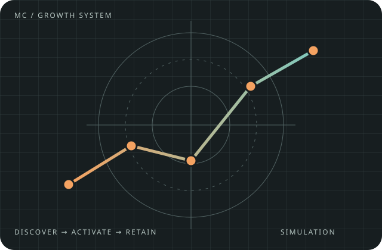

#  MarketCraft
Customer Growth & Marketing Strategy Studio — Blair Page

An independent portfolio demonstration of positioning, customer experience, campaign experimentation and acquisition economics for a fictional bicycle maintenance service. All inputs and customer hypotheses are illustrative; no interviews or actual campaign results are claimed.

## Run
Open `index.html` or publish this directory using GitHub Pages from the main branch root. No dependencies or API keys.

## Model
Bookings = qualified visits × booking conversion. Completed services = minimum of capacity and bookings × completion rate. Net contribution = completed services × contribution per service − campaign spend. Acquisition cost = campaign spend / completed services. This is a simplified monthly contribution model, not a full profit forecast.

## Strategy report
The full 18-page branded report is available in `docs/MarketCraft_Strategy.pdf` and as an accessible HTML edition on the homepage. All case assumptions are illustrative.

The PDF viewer displays all 18 pages as responsive images directly in the homepage, including on browsers without native PDF support. The original branded PDF is also available to open or download.
